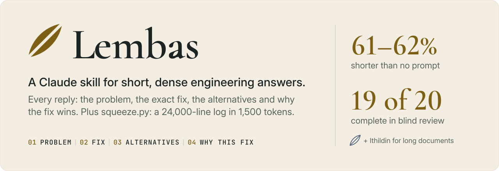

<picture>
  <source media="(prefers-color-scheme: dark)" srcset="brand/readme/hero-dark.svg">
  <source media="(prefers-color-scheme: light)" srcset="brand/readme/hero-light.svg">
  
</picture>

[](https://github.com/jmjohns9/lembas/actions/workflows/checks.yml)
[](LICENSE)

# Lembas

**Claude skills that spend fewer tokens: short, dense engineering answers, compressed logs and data, and long documents read one section at a time.**

## What is Lembas

In *The Lord of the Rings*, one small bite of elven bread called lembas feeds a traveler for a day. Lembas answers work the same way: small, because every sentence carries something you need.

Most of a typical AI reply isn't the answer. It's setup, a restated question, hedging, background nobody asked for and an offer to help. Lembas cuts those. What's left reads like a staff engineer's code review comment: the root cause, the exact fix and how to confirm it, the alternatives with when each one wins, and the trade-off that decides it.

Lembas also cuts what Claude **reads**. It queries large files before reading them, and it ships `squeeze.py`, which turns a 24,000-line log into a summary of about 1,300 tokens that keeps every distinct error. The repository holds a second skill, **Ithildin**, for long documents: it maps a 400-page book in about 2,000 tokens, then reads only the sections a question needs.

New to tokens and context windows? [docs/HOW_LEMBAS_WORKS.md](docs/HOW_LEMBAS_WORKS.md) explains them and walks through the code.

## Key features

- **Answers you can act on at once.** Every reply to a problem names the cause, gives the exact fix and how to confirm it, weighs the alternatives and says why the fix wins. Code, commands, paths and numbers are never shortened.
- **About 60% shorter replies.** No greetings, recaps or offers of help, and word budgets per kind of question. On the benchmark below, replies were 61% to 62% shorter than with no prompt, and more complete in blind review than the alternatives tested.
- **Complete where it matters.** Safety warnings, irreversible actions, multi-step procedures and anything saved outside the chat keep every step.
- **Big logs, JSON and CSV in a page.** `squeeze.py` keeps every distinct error and warning, counts repeats, profiles columns, flags outliers and points to the full original by line number, so exact answers are one `sed` away.
- **Long documents without reading them whole.** Ithildin maps PDFs, Word files, decks, Markdown and HTML, finds terms with their page and section, and reads one section at a time, with page citations.
- **Nothing to install, nothing sent anywhere.** Both scripts are standard-library Python 3.8+ and run locally. Optional libraries improve PDF reading.

## Results

| | "Answer concisely." | Lembas 1.1 | ultracave | **Lembas 2.0** |
|---|---:|---:|---:|---:|
| Shorter than no prompt (total) | 37% to 38% | 69% | 56% to 60% | **61% to 62%** |
| Shorter than "Answer concisely." (median) | | 47% to 48% | 34% to 35% | **35% to 37%** |
| Complete in blind review | | 12 of 20 | 17 of 20 | **19 of 20** |
| Answers with a factual error | | 2 | 4 | **1** |
| Decision quality (1 to 5) | | 3.90 | 4.45 | **4.85** |

Caveman's 10 developer questions, 2 runs, Claude Opus 5.5, counted with Claude's tokenizer. Blind reviewers scored anonymous answers against the full no-prompt answer. Full method and data in [docs/BENCHMARKS.md](docs/BENCHMARKS.md).

**Input tokens.** `squeeze.py` shrinks large logs, JSON and CSV by 95% to 99.8%. In end-to-end Claude Code runs on Opus 5.5, the skill cut total input by 10% to 15% and cost by 10% to 19%, with every answer correct. The optional hook cut input by 25% on Haiku 4.5. See [docs/SQUEEZE.md](docs/SQUEEZE.md).

**Long documents.** On six questions about a 126-page manual and a 395-page book, Ithildin cut input by 26% and turns by a third in Claude Code, with every answer correct in both arms. See [docs/ITHILDIN.md](docs/ITHILDIN.md).

## Quick start

**Claude Code:**

```bash
git clone https://github.com/jmjohns9/lembas.git
cp -r lembas/skills/lembas ~/.claude/skills/
cp -r lembas/skills/ithildin ~/.claude/skills/    # optional: long documents
```

Start a session and type `/lembas` or "lembas mode". It stays on until you say "stop lembas" or "normal mode". Ithildin triggers on its own when you ask about a long document, or with `/ithildin`.

**Claude apps (claude.ai, desktop):** download `lembas.skill` and `ithildin.skill` from the [latest release](https://github.com/jmjohns9/lembas/releases/latest), then open each in Claude and click **Save skill**. To build them yourself instead:

```bash
git clone https://github.com/jmjohns9/lembas.git
cd lembas
bash scripts/package.sh          # writes dist/lembas.skill and dist/ithildin.skill
```

The two skills are independent; install either or both.

**Optional Claude Code hook.** It squeezes large Bash and Read results automatically. It is worth it on smaller models or with raised output limits; see [docs/SQUEEZE.md](docs/SQUEEZE.md#should-you-install-the-hook).

```bash
python3 ~/.claude/skills/lembas/hooks/squeeze_hook.py --print-settings
```

Merge the JSON it prints into `~/.claude/settings.json`.

## Usage examples

The examples use test files the repository generates, so you can run them as written.

### 1. A reply in Lembas mode

**Prompt:** *My cron job works when I run it by hand but does nothing under cron.*

> **Problem.** Cron runs jobs with a minimal environment (`PATH=/usr/bin:/bin`, no shell profile), so `python3` from pyenv or Homebrew and any relative path fail, and cron discards the error.
>
> **Fix.** Use absolute paths and keep the output: `*/5 * * * * /usr/local/bin/python3 /opt/app/job.py >> /var/log/job.log 2>&1`. Wait one cycle and read the log to confirm.
>
> **Alternatives.** Set `PATH=` at the top of the crontab if many jobs share the same tools. Move to a systemd timer if you need retries, journald logging or a dependency on the network being up.
>
> **Why this fix.** It fixes the cause with a one-line change, and the redirect turns the next silent failure into a readable error.

Concept questions ("What's the difference between X and Y?") skip the labels: the mechanism, when to use each, and the common trap. More replies are in [evals/results/v2.0.0](evals/results/v2.0.0).

### 2. Squeeze a 24,000-line log

```bash
python3 tests/make_fixtures.py /tmp/lembas-demo
python3 skills/lembas/scripts/squeeze.py /tmp/lembas-demo/app.log --stats
```

Expected output (middle lines left out here):

```
[lembas squeeze: log, 24,007 lines, 235 error lines (2 distinct), 357 warnings. ~633,419 tokens shown as a summary. Full original: /tmp/lembas-demo/app.log ; grep -n or sed -n 'A,Bp' the original for any line range. Lines marked L123 are original line numbers.]
L1 2026-10-14 08:00:00,000 INFO  [http] GET /api/search 200 5ms rid=361424b1ea125c50
...
L266 2026-10-14 08:05:57,750 WARN  [db] slow query 1433ms: SELECT * FROM orders WHERE status = $1
      [this warning repeats 124× in total, last at L23952]
  … L267–L15873: 15607 lines collapsed (see summary below)
L15874 2026-10-14 13:57:08,550 ERROR [payment-worker-3] Unhandled exception while settling order 88412
L15875 Traceback (most recent call last):
L15876   File "/srv/app/payments/settle.py", line 142, in settle_order
L15877     customer = order.payload['customer_id']
L15878   File "/srv/app/payments/models.py", line 57, in __getitem__
L15879     return self._data[key]
L15880 KeyError: 'customer_id'
L15881 2026-10-14 13:57:09,900 ERROR [cache] redis.exceptions.ConnectionError: Error 111 connecting to 10.0.4.17:6379. Connection refused.
      [this error repeats 234× in total, last at L16347]
...
Collapsed lines: 23389 lines in 7 patterns. Most common (count × first example):
  5431× L8 2026-10-14 08:00:09,450 DEBUG [cache] hit key=user:5959 ttl=11s
  ...
squeeze: log, ~633,419 → ~1,252 tokens (100% smaller)
```

The last line goes to standard error. The count after the arrow varies by a few tokens with the length of the file's path. Piped output works the same way: `npm test 2>&1 | python3 skills/lembas/scripts/squeeze.py`.

### 3. Profile a CSV and catch an outlier

```bash
python3 skills/lembas/scripts/squeeze.py /tmp/lembas-demo/sales.csv
```

Expected output (start):

```
[lembas squeeze: csv, 9,000 rows × 7 columns. ~140,526 tokens shown as a summary. Full original: /tmp/lembas-demo/sales.csv ; compute exact sums, counts and filters on the original (pandas, csvkit, awk). Lines marked L123 are original line numbers.]
columns (7), 9,000 data rows:
  date (date): 2026-01-01 … 2027-01-10, 375 distinct
  region (text): "East"×2274, "West"×2256, "South"×2252, "North"×2218
  rep (text, 12 null): 20 distinct; top "W-rep-3"×479, "E-rep-3"×465, "E-rep-2"×464, "S-rep-4"×463
  product (text): "Enterprise"×2272, "Team"×2267, "Pro"×2249, "Starter"×2212
  units (int): min 1, max 40, mean 20.596, median 21, sum 185,364
  unit_price (float): 49.0×2297, 19.99×2285, 129.5×2221, 349.0×2197; min 19.99, max 349, mean 134.73, median 49, sum 1,212,602.65
  revenue (float): min 19.99, max 987,654.32, mean 2,888.30, median 1,323, sum 25,994,741.67
    ! max 987,654.32 at L6063 is 70.7× the next largest (13,960)
```

### 4. Find a fact in a long document

The test manual is built with the optional libraries (see [Running tests](#running-tests)):

```bash
.venv/bin/python tests/ithildin_fixtures.py /tmp/ithildin-demo
python3 skills/ithildin/scripts/ithildin.py map  /tmp/ithildin-demo/manual.md
python3 skills/ithildin/scripts/ithildin.py find /tmp/ithildin-demo/manual.md "coolant outlet temperature" "OF-7731-B"
python3 skills/ithildin/scripts/ithildin.py read /tmp/ithildin-demo/manual.md 7.3
```

`map` starts with a header and the outline (about 2,300 tokens for a 109,000-token manual):

```
[ithildin map: manual.md (Markdown, 64,925 words, ~108,858 tokens). 58 sections, 52 tables, 0 figures. Outline from Markdown headings. ...]
S1 ACME X-200 Maintenance Manual | L1-1390 | 64,925w
  1 General Information | L2-123 | 5,853w | Record the filter housing for wear and scoring; the nominal value is 558 kPa.
    1.1 Scope | L4-33 | 1,418w | Measure the pump assembly after the first 50 hours; the nominal value is 889 mm.
```

`find` gives each phrasing its own count and shows where each hit is (long lines are clipped):

```
[ithildin find: 'coolant outlet temperature': 1 hits in 1 sections (7.3); 'OF-7731-B': 1 hits in 1 sections (S58)]
== 'coolant outlet temperature' (1 hits)
>L769 §7.3 | Clean the coolant loop and log the reading in the maintenance record. ...
== 'OF-7731-B' (1 hits)
>L1383 §S58 | | Oil filter | OF-7731-B | 1 |
```

`read` returns just that section, starting `[ithildin read: 7.3 Operating Limits, L750-779]`. For a PDF, locations are pages (`p65-67`) instead of lines.

## Configuration

Everything works with no configuration. These settings change the defaults.

| Setting | Default | What it does |
|---|---|---|
| `LEMBAS_SQUEEZE_DIR` | `$TMPDIR/lembas-squeeze` | Where `squeeze.py` saves piped originals. The default folder is readable by you only |
| `LEMBAS_SQUEEZE` | `1` | Set to `0` to switch the hook off |
| `LEMBAS_SQUEEZE_BUDGET` | `1500` | Target size of the hook's summaries, in tokens |
| `LEMBAS_SQUEEZE_THRESHOLD` | `2000` | Results under this many tokens pass through the hook unchanged |
| `LEMBAS_RAW=1` | not set | Put it in front of a command (`LEMBAS_RAW=1 npm test`) and the hook leaves that command's output alone |
| `ITHILDIN_CACHE` | `$TMPDIR/ithildin` | Where Ithildin caches parsed documents. The default folder is readable by you only |
| `ITHILDIN_MAP_BUDGET` | `2500` | Target size of a map, in tokens |
| `LEMBAS_EVAL_MODEL` | `claude-opus-5-5` | Model used by the benchmark runners in `evals/` |

Command-line options:

| Command | Options |
|---|---|
| `squeeze.py [FILE]` (reads standard input without a file) | `--type auto\|log\|json\|jsonl\|csv\|text`, `--budget 1500`, `--threshold 2000`, `--stats` |
| `ithildin.py map FILE` | `--budget 2500`, `--depth N` (outline levels, counted from the document's top level) |
| `ithildin.py find FILE TERM...` | `--regex`, `-n 20` (hits shown per term), `-C 0` (lines of context) |
| `ithildin.py read FILE TARGET...` | targets are section ids (`7.3`), pages (`p71-73`) or lines (`L120-180`); `--max-tokens 8000` |
| `ithildin.py table FILE ID` | a table id from the map (`T12`) |

Ithildin reads PDF, DOCX, PPTX, Markdown, HTML and text with no extra software. It reads PDFs better with poppler's `pdftotext` (`brew install poppler`, `apt install poppler-utils`) or `pip install pypdf`, finds PDF table grids with `pdfplumber`, and reads `.rst`, `.odt`, `.epub` and similar through `pandoc` when it is installed.

## How it works

The two `SKILL.md` files are instructions Claude loads when a skill is active: Lembas sets the answer shape, word budgets and how to read large outputs, and Ithildin sets the map, find, read workflow. The scripts do the work on files. `squeeze.py` detects the input type, summarises it within a token budget, keeps every distinct error, saves the original and prints its path, and passes the input through unchanged when a summary would not save at least 30%. `ithildin.py` turns a document into lines with page numbers, finds its outline from the best source available (bookmarks, heading styles, type sizes or numbering), and caches the result so repeat calls take about a millisecond. [docs/HOW_LEMBAS_WORKS.md](docs/HOW_LEMBAS_WORKS.md) walks through both, step by step.

## Running tests

The skills need only the standard library. The tests use a few more packages to build PDF, Word and PowerPoint test documents:

```bash
python3 -m venv .venv
.venv/bin/pip install -r requirements-dev.txt
.venv/bin/python -m unittest discover -s tests
```

Expected: `Ran 488 tests` and `OK (expected failures=1)`. The one expected failure is the case [I-43](docs/CODE_REVIEW.md#i-43) leaves open: one chapter per page, numbered like the pages. Without the extra packages, `python3 -m unittest discover -s tests` still runs and skips the tests that need them.

Coverage and lint:

```bash
.venv/bin/coverage run -m unittest discover -s tests && .venv/bin/coverage combine && .venv/bin/coverage report
.venv/bin/ruff check .
```

To check the recorded benchmark replies and build the packages, as CI does:

```bash
python3 scripts/count_tokens.py evals/results/v2.0.0
python3 scripts/grade.py evals/evals.json evals/results/v2.0.0
bash scripts/package.sh
```

## Project structure

```
skills/lembas/SKILL.md                 The Lembas skill
skills/lembas/scripts/squeeze.py       Compressor for logs, JSON and CSV
skills/lembas/hooks/squeeze_hook.py    Optional Claude Code hook
skills/ithildin/SKILL.md               Ithildin, the long-document skill
skills/ithildin/scripts/ithildin.py    Document mapper: map, find, read, table
tests/                                 Test suite, golden outputs and test-file generators
evals/evals.json                       11 prompts and the facts each reply must keep
evals/results/                         Replies with and without Lembas, per version
evals/caveman-bench/                   Results on caveman's skill benchmark
evals/squeeze-bench/                   End-to-end input-token benchmark
evals/ithildin-bench/                  End-to-end long-document benchmark and results
scripts/                               Token counter, grader, packager
docs/                                  How it works, benchmarks, design notes, guides, code review
brand/                                 Logo and artwork, generated by brand/_build
```

## Contributing

Found a reply that left out something important? [Open an issue](https://github.com/jmjohns9/lembas/issues/new/choose) with the prompt and the reply. Changes to the skill need benchmark numbers; [CONTRIBUTING.md](CONTRIBUTING.md) explains how to run them. Code changes need the tests above to pass. Safety problems go through [SECURITY.md](SECURITY.md). Please follow the [code of conduct](CODE_OF_CONDUCT.md).

## Credits

Lembas started as a reverse engineering of [caveman](https://github.com/JuliusBrussee/caveman) by Julius Brussee. Several ideas come from it: answer first, keep the payload verbatim, persistence until switched off, and a pre-send check. Lembas drops caveman's fragment style in favor of natural sentences, and adds budgets, the four-part answer shape and input compression. See [NOTICE](NOTICE).

## License

[Apache License 2.0](LICENSE)
