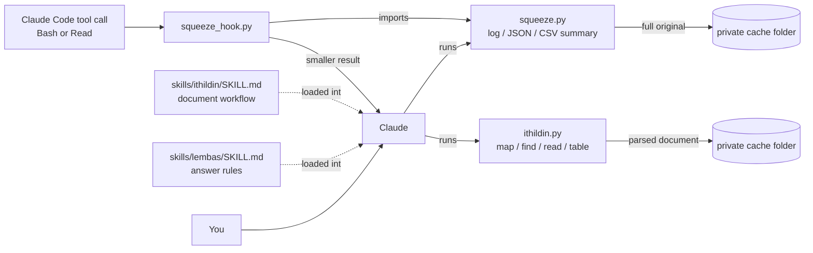

# How Lembas works

## Summary

Lembas is a pair of Claude skills that cut the number of tokens Claude spends on engineering work.

- **Lembas** changes how Claude answers: short replies in a fixed shape (problem, fix, alternatives, why), with no greetings, recaps or filler. It also teaches Claude to query large files before reading them, and ships `squeeze.py`, a compressor that turns a large log, JSON or CSV file into a summary of about 1,500 tokens.
- **Ithildin** handles long documents. Its script, `ithildin.py`, maps a PDF, Word file, deck or book into an outline of about 2,000 tokens, then reads only the sections a question needs.
- An optional **Claude Code hook** runs the compressor automatically on large tool results.

Both scripts are plain Python 3.8+ with no required dependencies. Nothing leaves your machine.

## How tokens work

### What a token is

Language models do not read characters or words. They read **tokens**: chunks of text from a fixed vocabulary, usually a common word, part of a word, a number fragment or a symbol. `configuration` might be one or two tokens; a UUID or a minified JSON line breaks into many.

There is no exact rule, but for planning, English prose runs about 4 characters per token and code, logs and data run about 3. Lembas uses three estimates of its own, each named in the code: 3 characters per token for logs and data (`squeeze.py`), 3.5 for technical documents (`ithildin.py`) and 4 for prose replies (`scripts/count_tokens.py`). All three undercount Chinese, Japanese and Korean text, which comes closer to one token per character.

### Why models use tokens

A fixed vocabulary of a few hundred thousand pieces can spell any text, while a vocabulary of whole words could not handle new names, code or typos. Tokens are what the model actually processes, so they are also what is measured, limited and billed.

### The context window

The **context window** is the most text a model can consider at once: the instructions, the whole conversation so far, every file or tool result read, and the reply being written. Current Claude models have a window of 1 million tokens.

In a coding agent like Claude Code, every tool call sends the whole conversation back to the model. A 50,000-token log read on turn 3 is part of the input on turn 4, turn 5 and every turn after it. Most of it is served from the prompt cache, which bills a repeat read at about a tenth of the normal input price, but it is still read, still billed and still taking room in the window.

### Cost, speed and limits

Tokens drive three things:

- **Cost.** You pay per token, separately for input and output.
- **Speed.** The model generates output one token at a time, so a 600-token reply takes several times longer to appear than a 150-token one. Large inputs also slow the start of each reply.
- **Limits.** The context window caps how much can be in play. Tools add their own caps: Claude Code's Read tool refuses files over 256 KB, and shows only about 30,000 characters of a command's output inline.

### Input and output pricing

Output tokens cost five times as much as input tokens on every current Claude model. Claude Opus 5.5, for example, costs $4 per million input tokens and $20 per million output tokens. Prices change; check Anthropic's pricing page for current numbers.

That ratio is why Lembas works on both sides:

- **Output.** Every word of a reply is billed at the higher rate, and a reply also becomes input on the next turn. Cutting a reply in half saves twice.
- **Input.** Input is cheaper per token but far larger in volume. One unfiltered log can outweigh a whole session of replies, and it is re-read on every later turn.

### Rule of thumb

- 1,000 tokens is about 750 English words, or about one and a half pages of prose.
- A 400-page book is about 250,000 tokens. Its Ithildin map is about 2,000.
- A 24,000-line application log is about 630,000 tokens by Lembas's estimate. Its squeezed summary is about 1,300.
- Anything Claude reads early in a session is paid for again, at the cache rate, on every turn that follows.

## What Lembas does

**Shorter answers.** `skills/lembas/SKILL.md` is a set of instructions Claude follows once the skill is active. It sets an answer shape for each kind of question (four labeled parts for problems and choices, no labels for concepts, one sentence plus code for code requests), word budgets (50 words for a quick fact, 130 for a concept, 200 for a problem or choice; code does not count), and a list of what to cut and what never to cut. It relaxes for safety warnings, irreversible actions, multi-step procedures, a confused user, and anything saved outside the chat. On the project's benchmark, replies were 61% to 62% shorter than with no prompt.

**Less reading.** The same file tells Claude to size a file before reading it, to ask narrow questions with `grep` or `jq`, to batch related queries into one command, and to send output it cannot narrow through `squeeze.py`. For exact counts or sums it computes on the original, never from a summary.

**Compressed tool output.** `squeeze.py` replaces a large log, JSON or CSV file with a summary that keeps every distinct error and warning, counts repeated lines, profiles columns and describes JSON structure. The original is saved, and every line in the summary carries its original line number, so Claude can go back for exact lines.

**Long documents.** `ithildin.py` turns a long document into a map (outline, page ranges, word counts, a one-line gist per section, tables, defined terms), finds terms with their page and section, and reads one section or page range at a time.

## How the code works

### Architecture



There are three moving parts. The two `SKILL.md` files are prompts: Claude reads them and changes how it works. The two scripts do the token-saving work on files. The hook connects the compressor to Claude Code so it runs without Claude having to ask.

### A request, step by step: squeezing a test run

You run `npm test 2>&1 | python3 skills/lembas/scripts/squeeze.py`.

1. **Read and clean** (`main`, `clean`). The script reads standard input as bytes and decodes it as UTF-8. It removes terminal colour codes, progress bars that redraw a line with carriage returns, and a leading byte-order mark.
2. **Small enough? Stop.** It estimates the tokens (`est_tokens`). Under 2,000, the text is printed unchanged.
3. **Detect the type** (`detect`). A file name decides first (`.json`, `.csv`, `.py`...). Without one, it tries to parse JSON, then looks for one JSON object per line, a diff, a delimited table, source code, or log-like lines with timestamps and levels. Source code, diffs and prose pass through unless they are over 40,000 tokens, because a summary of code would break edits.
4. **Summarise** (`squeeze_log`, `squeeze_json`, `squeeze_csv`, `squeeze_text`). For a log, each line gets a severity (error, warning, other) and a template, with numbers, IDs and timestamps masked. Errors are grouped with their stack traces; the first occurrence of each distinct error is shown with up to three lines of lead-up, and repeats are counted. Ordinary lines collapse into their templates with a count and a first example. The head and tail of the log stay as they were. If the result is over the budget (1,500 tokens by default), it renders again with fewer details, down to five levels.
5. **Worth it? Decide before saving.** A one-line header names the type, the key facts, the original size and where the full original is. If the summary saves less than 30%, the input is printed unchanged and nothing is saved.
6. **Keep the original.** Piped input is written to a private cache folder (`$TMPDIR/lembas-squeeze`, readable by you only, named by a hash of the content). Saved copies older than `LEMBAS_SQUEEZE_KEEP_HOURS` (default 24) are deleted at the same time. If that fails, the input is printed unchanged: a summary must always point at its original.
7. **Print** (`_write`). Output is written as UTF-8 whatever the terminal reports.

With the hook installed, the same thing happens inside Claude Code without the pipe. After a Bash or Read call, Claude Code sends the hook the call and its result as JSON. The hook leaves small results, source code, and deliberate queries (`grep`, `head`, `jq`...) alone, and replaces large data results with the summary. Before a Read of a data file over 256 KB, which would fail, it declines the read and hands Claude the summary and the path instead.

### A request, step by step: a question about a long document

Claude runs `python3 skills/ithildin/scripts/ithildin.py map manual.pdf`.

1. **Cache check** (`load`). Entries older than `ITHILDIN_CACHE_HOURS` (default 24) are deleted first. The cache key is a hash of the file, the script itself and the file extension. A hit loads the parsed document from JSON in about a millisecond.
2. **Extract lines** (`extract_pdf`, `extract_docx`, `extract_pptx`, `extract_markdown`, `extract_html`, `extract_text`). Every format becomes a list of lines, each with its page (or none). PDFs go through `pdftotext` when it is installed, otherwise `pypdf`. Running headers and footers that repeat on many pages are removed.
3. **Find the outline**, from the most reliable source available: PDF bookmarks, Word heading styles, slide titles, Markdown headings, larger type sizes, then section numbering and layout. The map says which one it used.
4. **Finish** (`finish`). Give each section an id (its own number when unique, otherwise S1, S2...), a word count, a page range and a one-sentence gist. Find table and figure captions and defined terms.
5. **Render the map** (`render_map`). If the outline is over the budget (2,500 tokens by default), drop the deepest levels and gists until it fits.

Claude then runs `find` with a few phrasings (each hit shows its page and section), `read` with a section id or page range (long reads stop at 8,000 tokens and say where to continue), and `table` for a table as rows. It answers with a page citation for each fact.

### Modules

| File | What it does |
|---|---|
| `skills/lembas/SKILL.md` | The Lembas prompt: answer shapes, budgets, what to cut, how to read large outputs, when to relax |
| `skills/lembas/scripts/squeeze.py` | Compressor. `detect` picks the type; `squeeze_log`, `squeeze_json`, `squeeze_csv` and `squeeze_text` summarise; `squeeze` runs the whole pipeline and saves the original; `main` is the command line |
| `skills/lembas/hooks/squeeze_hook.py` | Claude Code hook. `on_bash` and `on_read_post` replace large results after the call; `on_read_pre` turns an over-limit Read into a summary; `--print-settings` prints the JSON to install it |
| `skills/ithildin/SKILL.md` | The Ithildin prompt: when to use it, map, find, read, table, and how to cite |
| `skills/ithildin/scripts/ithildin.py` | Document mapper. One `extract_*` function per format; `finish` builds sections; `render_map`, `render_find`, `render_read` and `render_table` are the four commands; `load` caches parsed documents |
| `scripts/count_tokens.py` | Compares reply length with and without Lembas for a results folder |
| `scripts/grade.py` | Checks each reply keeps its required facts and follows the answer shape; fails if a Lembas reply does not |
| `scripts/package.sh` | Builds `dist/lembas.skill` and `dist/ithildin.skill` for the Claude apps |
| `evals/` | Benchmark prompts, recorded replies and the end-to-end benchmark runners (these need the `claude` CLI and an account) |
| `tests/` | The test suite (see the README) and generators for the test files |

## Getting started

Clone the repository; nothing needs to be installed to use the scripts:

```bash
git clone https://github.com/jmjohns9/lembas.git
cd lembas
```

Make some test data and squeeze it:

```bash
python3 tests/make_fixtures.py /tmp/lembas-demo
python3 skills/lembas/scripts/squeeze.py /tmp/lembas-demo/app.log --stats
```

The last line, on standard error, shows the saving: `squeeze: log, ~633,419 → ~1,286 tokens (100% smaller)`. The exact count after the arrow varies by a token or two, because the summary's header includes the file's path.

To use the skills in Claude Code, copy them into your skills folder:

```bash
cp -r skills/lembas ~/.claude/skills/
cp -r skills/ithildin ~/.claude/skills/
```

Then type `/lembas` or "lembas mode" in a session. Ithildin triggers on its own when you ask about a long document. To install the hook, run `python3 ~/.claude/skills/lembas/hooks/squeeze_hook.py --print-settings` and merge the JSON it prints into `~/.claude/settings.json`.

## Glossary

| Term | Meaning |
|---|---|
| Token | The unit a model reads and writes: a word, part of a word, a number fragment or a symbol |
| Context window | The most tokens a model can consider at once, including the whole conversation and everything read |
| Input tokens | Tokens sent to the model: instructions, conversation, files, tool results |
| Output tokens | Tokens the model writes; five times the price of input on current Claude models |
| Prompt cache | Reuse of an unchanged conversation prefix across calls, billed at about a tenth of the input price |
| Skill | A folder with a `SKILL.md` that Claude loads when its description matches the task, plus any scripts it uses |
| Hook | A command Claude Code runs before or after a tool call; it can change or block the call's result |
| Squeeze | `squeeze.py`'s summary of a large log, JSON or CSV file, with a header that points at the full original |
| Budget | The target size of a summary or map in tokens (1,500 for a squeeze, 2,500 for a map by default), or the word limit for a reply |
| Threshold | Inputs below this many estimated tokens (2,000 by default) pass through `squeeze.py` unchanged |
| Template | A log line with its numbers, IDs and timestamps masked, used to count repeats |
| Map | Ithildin's outline of a document: sections, page ranges, word counts, gists, tables and defined terms |
| Gist | The first sentence of a section, clipped to 28 words, shown in the map |
| Section id | A section's own number (`7.3`) or, when there is none or it repeats, a generated one (`S12`) |
